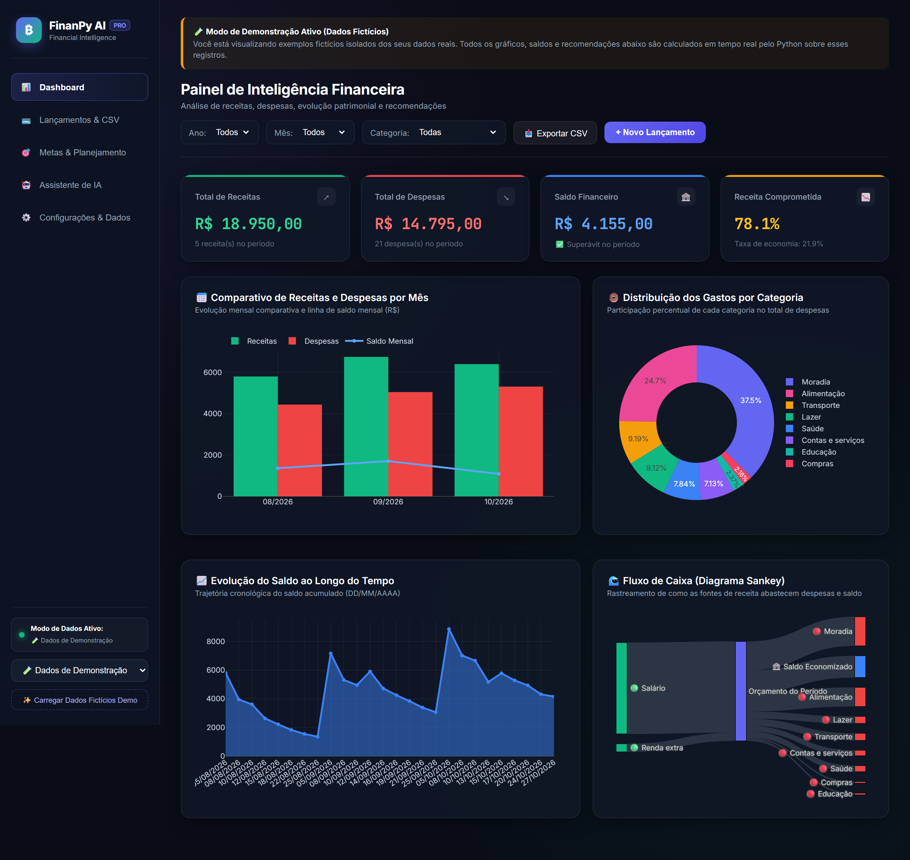
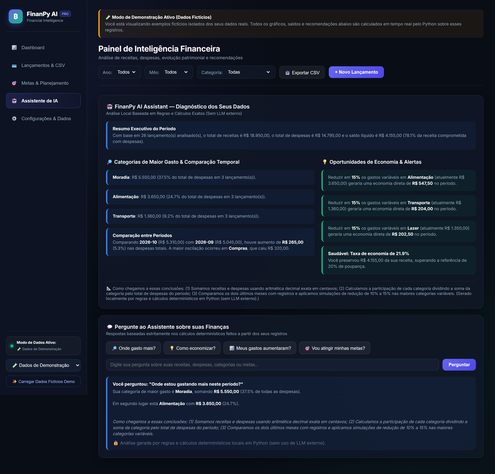
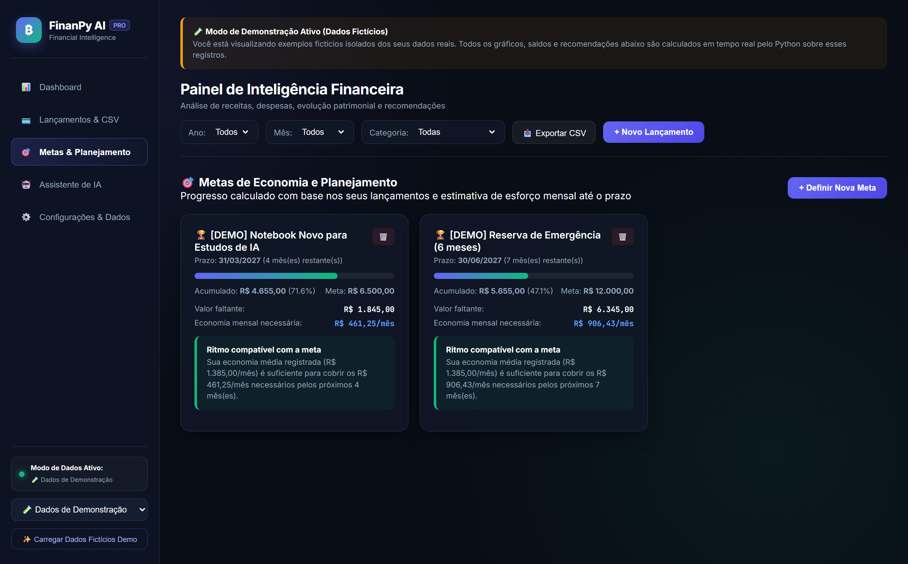
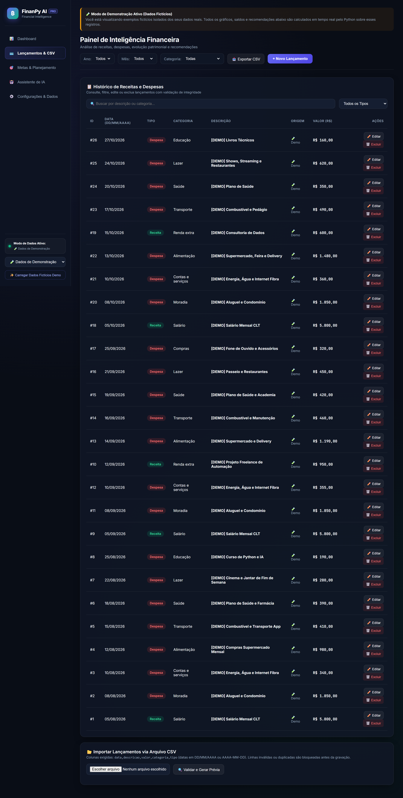

# 🤖 FinanPy AI PRO — Assistente Inteligente de Análise Financeira Pessoal

Aplicação web Full-Stack de análise e planejamento financeiro pessoal desenvolvida em **Python** com **Flask**, **HTML5/CSS3/JS (Dark Fintech Glassmorphism)**, **Pandas**, **Plotly**, **SQLite** e um **Assistente de IA Híbrido** (motor determinístico local + integração opcional com LLM).

Este projeto foi construído como portfólio prático para demonstrar engenharia de software, modelagem de dados, precisão em cálculos financeiros, testes automatizados e aplicação responsável de Inteligência Artificial.

---

## 📸 Demonstração Visual (Capturas de Tela Reais da Aplicação)

> *Nota de transparência: As capturas abaixo foram geradas a partir da aplicação em execução real utilizando o conjunto de dados de demonstração (`[DEMO]`), com todos os indicadores, gráficos e recomendações calculados pelo Python.*

### 1. Dashboard Financeiro Interativo (KPIs, Comparativo Mensal, Categorias, Saldo e Fluxo Sankey)


### 2. FinanPy AI Assistant (Diagnóstico Determinístico, Oportunidades de Economia e Q&A)


### 3. Metas de Economia e Planejamento Mensal


### 4. Gestão de Lançamentos e Importação/Exportação CSV com Validação Prévia


---

## 🎯 1. Problema que a Aplicação Resolve

Muitas pessoas registram gastos em planilhas soltas ou aplicativos que misturam números sem explicar de onde vêm os cálculos ou quanto realmente precisam poupar por mês para atingir um objetivo. Além disso, o uso direto de modelos de linguagem (LLMs) para somar valores financeiros frequentemente gera erros de cálculo ("alucinações numéricas") e expõe descrições pessoais sensíveis.

O **FinanPy AI** resolve esse problema unindo:
1. **Aritmética monetária exata** (armazenamento em centavos inteiros e cálculos com `Decimal`, evitando erros de ponto flutuante).
2. **Análise determinística em Python** que calcula todos os indicadores, variações mensais e metas antes de qualquer interpretação textual.
3. **Assistente de IA transparente e privado**, que funciona 100% localmente sem depender de chave de API externa e, quando integrado opcionalmente a um LLM, envia apenas resumos estatísticos anonimizados (nunca descrições pessoais).

---

## ✨ 2. Funcionalidades Implementadas vs. Planejadas

### Funcionalidades Implementadas (Verificadas e Testadas)
- **Dashboard Financeiro Interativo**: Total de receitas, despesas, saldo do período, percentual da receita comprometido, gráfico comparativo mensal (receitas × despesas), gráfico de rosca por categoria e linha de evolução do saldo acumulado.
- **Filtros Dinâmicos**: Filtragem por Ano, Mês, Categoria, Tipo e busca textual.
- **Gestão Completa de Lançamentos (CRUD)**: Criação, consulta, edição e exclusão com confirmação, validação de datas (`DD/MM/AAAA` e `AAAA-MM-DD`) e bloqueio de categorias incompatíveis entre `Receita` e `Despesa`.
- **Categorias Editáveis**: Adição e remoção de categorias personalizadas separadas por tipo, protegendo categorias que já possuem lançamentos vinculados.
- **Importação e Exportação CSV**: Validação prévia linha a linha antes de gravar, exibição de prévia, relatório detalhado de linhas com erro, detecção automática de duplicatas (no arquivo e no banco) e exportação filtrada em CSV.
- **Metas e Planejamento**: Cadastro de metas de economia com prazo, cálculo de progresso real, estimativa de economia mensal necessária e alertas automáticos quando o saldo ou a média histórica indicam dificuldade para cumprir a meta.
- **FinanPy AI Assistant**: Resumo executivo do período, identificação dos maiores gastos, comparação entre meses, sugestões de economia calculadas sobre categorias variáveis e chat de perguntas e respostas sobre os dados (modo determinístico local + integração opcional via `.env` com Google Gemini ou OpenAI).
- **Conjunto de Demonstração Isolado**: Opção para carregar e remover 26 lançamentos fictícios de 3 meses (`is_demo = 1`) sem misturar nem afetar os dados reais do usuário (`is_demo = 0`).

### Melhorias Futuras (Planejadas)
- Autenticação multiusuário com criptografia de banco de dados em repouso (SQLCipher).
- Suporte a despesas parceladas recorrentes automáticas.
- Importação de arquivos no formato bancário `.ofx`.

---

## 🛠️ 3. Tecnologias Utilizadas e Justificativa

| Tecnologia | Papel no Projeto | Justificativa da Escolha |
| :--- | :--- | :--- |
| **Python 3.11+** | Linguagem principal | Ecossistema maduro para análise de dados, finanças e IA, com código legível e didático. |
| **Flask + HTML5/CSS3/JS** | Servidor Web & UI Dark Fintech (`app.py`, `templates/`, `static/`) | Interface moderna em modo escuro (*Fintech Dark Glassmorphism*) sem protótipos fictícios, comunicando-se via API REST JSON. |
| **Pandas** | Processamento Analítico | Agrupamentos por categoria (`groupby`), tabelas dinâmicas mensais (`pivot_table`) e séries temporais. |
| **Plotly** | Visualização de Dados | Gráficos interativos responsivos (Evolução Mensal, Rosca por Categoria, Linha de Saldo e Diagrama Sankey). |
| **SQLite (`sqlite3`)** | Banco de Dados Local | Nativo do Python, suporta transações atômicas (`ACID`), constraints `CHECK` e consultas parametrizadas sem exigir servidor externo. |
| **Pytest** | Testes Automatizados | Validação rápida e reprodutível das regras de negócio, rotas REST, casos-limite e importação CSV. |
| **python-dotenv** | Configuração Segura | Carrega chaves opcionais de API a partir de arquivo `.env` local ignorado pelo Git. |

---

## 📂 4. Estrutura de Diretórios

```text
FinanPy/
├── app.py                      # Servidor principal Full-Stack Flask + API REST (FinanPy AI PRO)
├── FinanPy.py                  # Ponto de entrada alternativo (atalho para app.py)
├── requirements.txt            # Dependências do projeto
├── README.md                   # Documentação principal
├── .gitignore                  # Proteção contra versionamento de .venv, .env e *.db
├── .env.example                # Modelo de variáveis de ambiente opcionais
├── templates/
│   └── index.html              # Interface SPA em HTML5 (Dashboard, Lançamentos, Metas, IA, Config)
├── static/
│   ├── css/style.css           # Design System Dark Fintech Glassmorphism
│   └── js/app.js               # Lógica Front-End (Fetch API, Plotly.js, Validação CSV)
├── data/                       # Diretório do banco SQLite local (ignorado no Git)
├── src/
│   ├── __init__.py
│   ├── database.py             # Conexão SQLite, criação de tabelas e categorias editáveis
│   ├── validators.py           # Validações com Decimal, datas BR/ISO e regras de domínio
│   ├── transactions.py         # CRUD de lançamentos, importação/exportação CSV e dados demo
│   ├── analytics.py            # Cálculos de indicadores, comparativo mensal, Sankey e variações
│   ├── goals.py                # Metas de economia, cálculo de esforço mensal e alertas
│   └── ai_assistant.py         # FinanPy AI Assistant (motor determinístico + LLM opcional)
├── tests/
│   ├── test_validators.py      # Testes de precisão monetária, datas e validações
│   ├── test_transactions.py    # Testes de CRUD, filtros, rotas Flask e isolamento demo
│   ├── test_import_export.py   # Testes de importação CSV válida/inválida, duplicatas e exportação
│   └── test_analytics.py       # Testes de indicadores, metas, casos-limite e assistente IA
└── docs/
    ├── architecture.md         # Diagrama e decisões arquiteturais
    └── test-report.md          # Relatório real de execução dos testes automatizados
```

---

## 💻 5. Como Instalar e Executar no VS Code (Passo a Passo)

1. **Abra a pasta do projeto no VS Code** e abra o terminal integrado (<kbd>Ctrl</kbd> + <kbd>'</kbd>).
2. **Ative o ambiente virtual (`.venv`):**
   ```powershell
   .\.venv\Scripts\Activate.ps1
   ```
3. **Instale as dependências:**
   ```powershell
   pip install -r requirements.txt
   ```
4. **Inicie o servidor FinanPy AI PRO:**
   ```powershell
   python app.py
   ```
5. Abra no navegador: **`http://127.0.0.1:5000`**.

---

## 🧪 6. Como Executar os Testes Automatizados

No terminal do VS Code (com o `.venv` ativo), execute:

```powershell
pytest -v
```

Ou diretamente pelo executável do ambiente virtual:

```powershell
.\.venv\Scripts\python.exe -m pytest -v
```

---

## 🎭 7. Como Utilizar os Dados Fictícios de Demonstração

Para testar os gráficos, filtros, metas e o Assistente de IA imediatamente sem precisar cadastrar dezenas de lançamentos manualmente:
1. Na **barra lateral esquerda**, em **🗂️ Fonte de Dados Ativa**, selecione **🧪 Dados de Demonstração (Fictícios)**.
2. Clique no botão **✨ Carregar Lançamentos Fictícios**.
3. O sistema carregará **26 lançamentos fictícios** distribuídos entre Agosto, Setembro e Outubro de 2026 (marcados com o prefixo `[DEMO]` e `is_demo = 1` no banco) e **2 metas de exemplo**.
4. **Diferenciação clara:** Os números exibidos no modo Demonstração são **exemplos fictícios** de entrada, porém todos os totais (ex.: `R$ 19.150,00` de receitas, `R$ 15.155,00` de despesas e `R$ 3.995,00` de saldo), percentuais e gráficos são **efetivamente calculados em tempo real** pelo código Python sobre esses registros.
5. Para apagar os exemplos, basta clicar em **🧹 Remover Dados de Demonstração** — seus lançamentos reais em **👤 Meus Dados Reais** jamais são afetados.

---

## 🤖 8. Como Funciona e Como Configurar o Assistente de IA

O **FinanPy AI Assistant** funciona em duas camadas:
1. **Camada Determinística Local (Sempre Ativa):** Não precisa de internet nem de chave de API. Calcula resumos, identifica as categorias mais caras, compara os últimos meses, simula reduções de 15% em despesas variáveis e responde perguntas com base em regras explícitas em Python.
2. **Camada LLM Externa (Opcional):** Caso deseje que um modelo de linguagem redija respostas conversacionais sobre o resumo calculado:
   - Copie o arquivo `.env.example` para um novo arquivo chamado `.env` na raiz do projeto.
   - Adicione sua chave em `GEMINI_API_KEY=sua_chave_aqui` ou `OPENAI_API_KEY=sua_chave_aqui`.
   - Reinicie o `streamlit run app.py` e marque a caixa de autorização na aba **🤖 Assistente de IA**.

---

## 📸 9. Capturas de Tela

Para adicionar capturas de tela ao seu repositório após iniciar o aplicativo:
1. Com o app aberto em `http://localhost:8501`, ative os **Dados de Demonstração**.
2. Pressione <kbd>Win</kbd> + <kbd>Shift</kbd> + <kbd>S</kbd> para capturar a tela do **Dashboard** e da aba **Assistente de IA**.
3. Salve as imagens na pasta `docs/` (ex.: `docs/screenshot-dashboard.png`) e referencie-as aqui no `README.md`.

---

## 🔒 10. Limitações Conhecidas e Segurança

- **Escopo de Uso Individual e Local:** Esta versão armazena os dados em um arquivo SQLite local (`data/finanpy_ai.db`) e é destinada ao uso individual em computador pessoal.
- **Sem Autenticação Multiusuário ou Segurança Bancária:** A aplicação não implementa login multiusuário nem criptografia de disco de nível bancário.
- **Boas Práticas Implementadas:** Todas as queries SQL utilizam parâmetros vinculados (`?`) contra SQL Injection, entradas passam por validação estrita com `Decimal`, descrições pessoais nunca são enviadas a APIs externas e o arquivo `.gitignore` bloqueia o envio de arquivos `.db` e `.env` ao GitHub.

---

## 🧠 11. Decisões Técnicas e Uso de IA no Desenvolvimento

- **Por que separar o cálculo em Python da IA generativa?** Modelos de linguagem são probabilísticos e podem errar somas simples. Por isso, toda a matemática financeira foi isolada em `src/analytics.py` e `src/goals.py` usando `Decimal` e centavos inteiros.
- **Como a IA foi utilizada durante o desenvolvimento:** A IA atuou como par de programação para estruturar a arquitetura modular (`src/` e `tests/`), desenhar casos de teste de borda no `pytest` (como divisão por zero quando não há receitas e detecção de duplicatas em CSV) e revisar a clareza didática do código.
