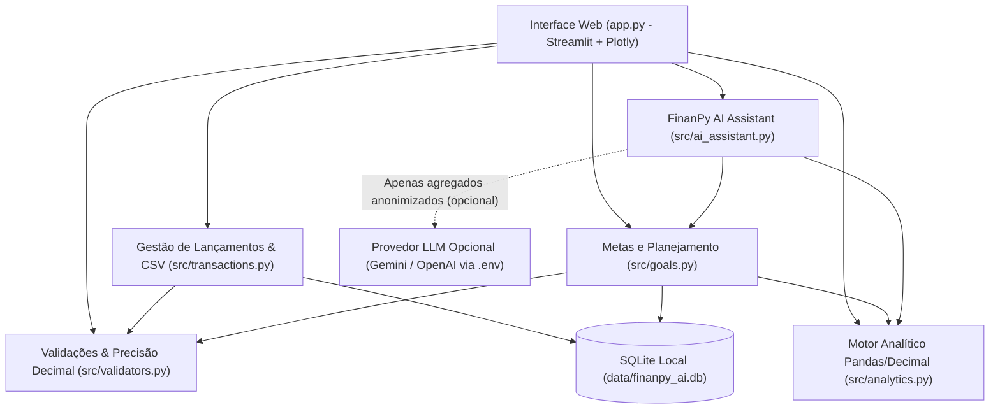

# 🏗️ Arquitetura do Sistema — FinanPy AI

## 1. Visão Geral e Princípios de Projeto

O **FinanPy AI** foi arquitetado seguindo o princípio de **Separação de Responsabilidades (Separation of Concerns — SoC)**, dividindo claramente a camada de interface web (`app.py`), a validação de domínio (`src/validators.py`), a persistência relacional (`src/database.py` e `src/transactions.py`), o motor de cálculo analítico (`src/analytics.py` e `src/goals.py`) e o assistente inteligente (`src/ai_assistant.py`).

---

## 2. Decisões Técnicas Principais

### 2.1. Precisão Monetária (Centavos + `Decimal`)
Cálculos em ponto flutuante binário (`float` padrão IEEE 754) sofrem imprecisões clássicas (como `0.1 + 0.2 = 0.30000000000000004`). Para evitar erros de arredondamento:
1. Toda entrada monetária passa por `para_decimal()` em `src/validators.py` usando `Decimal` com arredondamento financeiro `ROUND_HALF_UP`.
2. No banco SQLite (`src/database.py`), os valores são armazenados como **inteiros em centavos** (`valor_centavos INTEGER NOT NULL CHECK(valor_centavos > 0)`).
3. As somas de receitas, despesas e saldos em `src/analytics.py` são feitas sobre os centavos inteiros e convertidas para `Decimal` antes da exibição.

### 2.2. Isolamento entre Dados Reais e Dados de Demonstração (`is_demo`)
Tanto a tabela `lancamentos` quanto a tabela `metas` possuem a coluna `is_demo INTEGER NOT NULL DEFAULT 0`.
- Quando o usuário seleciona **Meus Dados Reais**, todas as consultas filtram `WHERE is_demo = 0`.
- Quando seleciona **Dados de Demonstração**, as consultas filtram `WHERE is_demo = 1`.
- Isso garante que carregar ou remover os dados fictícios nunca apague nem contamine os lançamentos reais do usuário.

### 2.3. Assistente de IA Híbrido e Seguro (`src/ai_assistant.py`)
- **Camada Determinística Primeiro**: Todos os totais, percentuais, rankings de categorias e variações entre meses são calculados em Python (`src/analytics.py`). O assistente nunca inventa números.
- **Modo Local Autônomo**: Sem chave de API configurada, o assistente opera 100% localmente respondendo perguntas e gerando recomendações baseadas em regras explícitas.
- **Privacidade e Anti-Prompt Injection**: Quando o usuário opta por ativar um LLM externo via `.env`, a função `gerar_resumo_anonimizado()` envia apenas agregados numéricos por categoria e mês — **nunca envia as descrições individuais dos lançamentos** — e sanitiza caracteres de controle.
